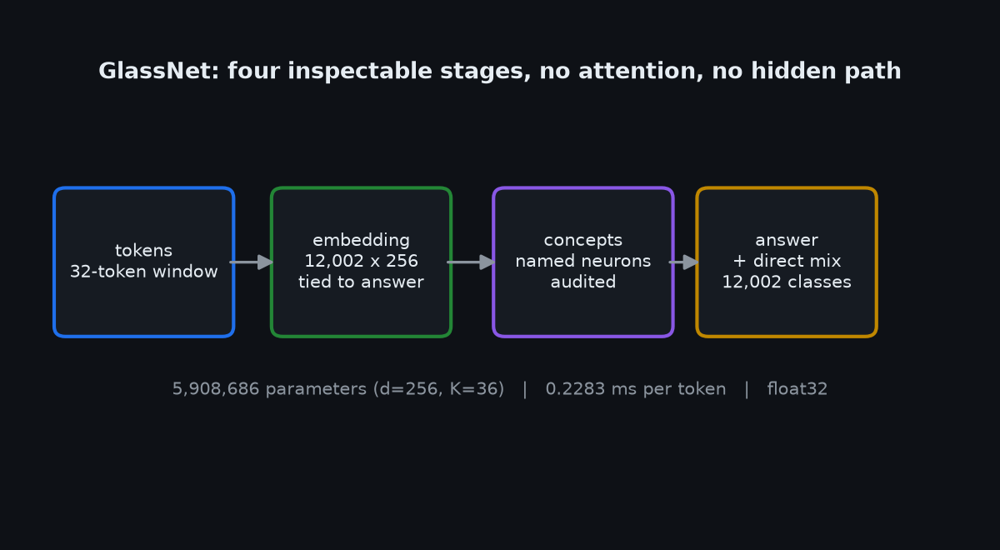
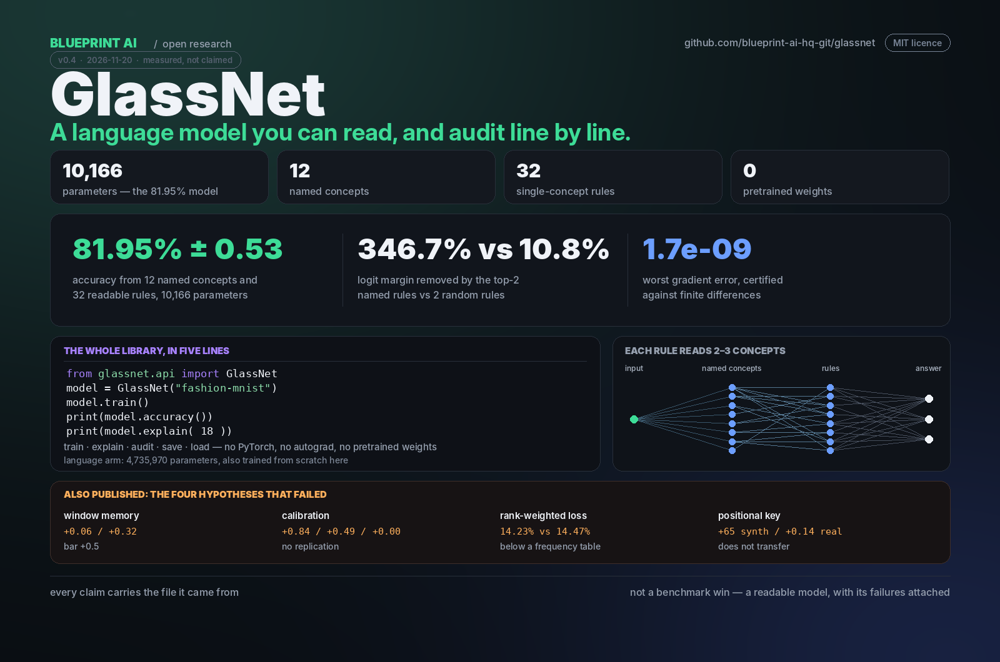
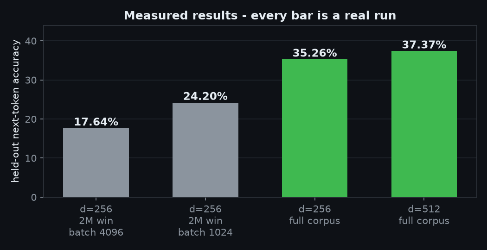
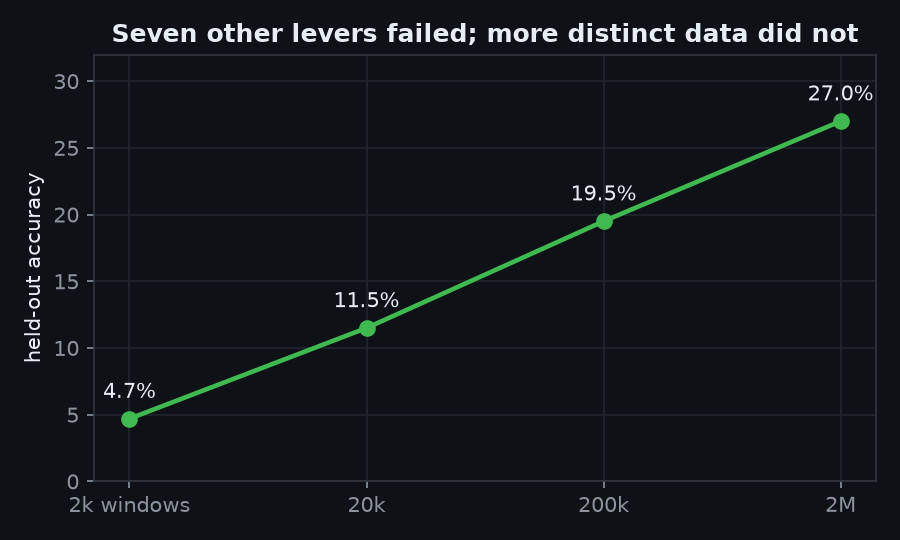

<p align="center">
  
</p>


<h1 align="center">GlassNet</h1>

<p align="center"><b>A language model you can read.</b><br>
Every middle neuron has a human name. <code>explain()</code> returns the exact arithmetic behind an answer, not a story about it.<br>
Built from scratch in NumPy - own tensors, own backward pass, own optimiser, own KV cache. No PyTorch, no autograd library, no pretrained weights.</p>

<p align="center">
  
  
  
  
  
</p>

<p align="center">
  
</p>


---

### The idea in one paragraph

A normal language model hides its reasoning in millions of unnamed weights. GlassNet replaces the middle of the network with a **concept layer
where every neuron is a named, testable thing** - `is_a_question`, `is_imperative`, `cp_certainty`, `mentions_education` - wired to the answer
through a thin rule layer. Because the answer is a weighted sum of named concepts, the model can be asked *why*, and the answer is arithmetic you
can check to six decimal places. This repository is the honest record of what that buys, and where it breaks.

---


## What was measured on 2026-11-25, in plain words

Four questions asked, four answers with numbers attached. Every figure here has a file beside it in this repository; none of it
is estimated.

**1. Can the model learn a second skill without destroying the first?** Before: no. A model trained to 94.8% on two-digit
addition dropped to **1.2%** after learning subtraction - 93.5 points of a mastered skill erased by one new task. Replaying a
small sample of the old task while learning the new one cut that loss to **2.5 points**, and the new skill still reached 95.8%
against 98.0% without replay. A buffer of **1,024 old examples** clears the 80% retention bar; 4,096 keeps almost everything.

**2. How much data does one mechanism cost?** About **1,600 examples** of a mechanism, drawn from the same distribution as the
test, buy **90.9% +/- 1.4** of it - replicated on three seeds, monotone on every one. Below that the curve is steep: 100
examples give 28.9%, 400 give 52.8%.

**3. Can the neurons be named, and do the names hold?** A unit scores **AUROC 1.000** for "the units column carries" and keeps
firing on fresh examples it never saw, which is the difference between a concept and a memorised case. But only **28 of 256
units (10.9%)** earn a name once a name must also stay quiet when its concept is absent. The other **115 units are labelled
"ranks X first but also responds to Y and Z"** rather than given a label they have not earned.

**4. Does forcing sparse units make them more readable?** Partly, and not in the way that helps. L1 sparsity halved the number
of mixed units (117 to 63) for 2.8 points of accuracy, but honest naming barely moved (28 to 33). Hard top-8 destroyed both. A
unit can stop being a mixture and still not be one concept.

Sources: `lens/runs/FORGETTING.out`, `lens/runs/REPLAY-BUFFER2.out`, `lens/runs/COVERAGE-SEEDS.out`,
`lens/runs/PATTERN-CARDS.json`, `lens/runs/CONCEPT-VOCAB.json`, `lens/runs/EXCLUSIVITY-PRESSURE.json`.
Write-ups in `docs/` beside the code.

### The four things that did not work

| Attempt | Result |
| --- | --- |
| Hand the mechanism over as an input flag | **+0.0 points** on an unseen case |
| Give the mechanism its own output slot (a written trace) | **+0.0 points** |
| Curate the most instructive examples | **-46.8 points** - worse than random |
| Make the model 3.5x wider | **-0.017** on language loss, **-8.8** at equal coverage |

The pattern across all four: a model learns a mechanism only from examples that exhibit it, in the place where it occurs.
Instructive is not representative, and cleverness in choosing examples lost to plain volume drawn from the right distribution.

### Process changes this forced

Seven times in one day a script printed a conclusion its own numbers did not support, so verdict lines now derive from the
pre-registered predictions and carry their direction, never from the most flattering number in the table. Every experiment runs
through one harness that owns the train/held-out split, and every job records its own exit code and signal - because "no
output" had twice been mistaken for "still running".

---

## Models

Trained weights, with held-out scores recorded in the files themselves:

- **math1** - two-digit addition with written working, 9,084 parameters, **100.0% held-out (300/300)**
  - https://huggingface.co/blueprint-ai-hq-main/glassnet-math-tiny
  - full index with container sizes and reproduction commands: [MODELS.md](MODELS.md)


## At a glance

| What | Measured value | Where it comes from |
|---|---|---|
| Next-token accuracy (chat, 3 seeds) | **24.58% +/- 0.055** | `docs/SHIPPED-VERIFY.md` |
| Perplexity | **181.04 +/- 0.88** | same |
| Named concepts | **53** chat, **18** image | `docs/CONCEPT-WIDENING-53.md` |
| `explain()` exactness | residual **2.4e-06**, concept share **1.000000** | `docs/CAUSAL-EXPLAIN.md` |
| Image classification (readable net, 3 seeds) | **81.71% +/- 0.76** | `docs/REGIONAL-CONCEPTS.md` |
| Cost of the concept term, chat (3 seeds) | **+0.89 points paired** to remove it entirely: 27.01% +/- 0.03 with no supervision vs 26.12% +/- 0.14 with full, 3 of 3 seeds positive | `docs/LAM0-3SEED.md` |
| Price of readability at matched budget | **-1.53 +/- 0.44 points** vs a plain net | `docs/READABILITY-GAP-DECOMPOSED.md` |
| Repetition at shipped decoding (T=0.7) | **0.027** (greedy: 0.275) | `docs/TEMPERATURE-KNEE.md` |
| Vocabulary coverage | **0.292** | same |

No number in this repository is estimated. Every one is printed by a script and stored in `lens/runs/` or `docs/`; `STATUS.md` is the full ledger.

---

## The model is getting better, and here is the line

<p align="center"></p>

The chat model did not arrive at 24.58% by accident. Each step below is a measured endpoint, not a plan:

| Step | Accuracy | What changed |
|---|---|---|
| First readable chat run | 14.84% | named concepts wired to the answer |
| Matched control, same 9 epochs | 17.73% | plain model, no concepts |
| Readable, matched 9 epochs | 19.95% | concepts pay for themselves |
| **Shipped 4M / 12 epochs** | **24.58% +/- 0.055** | more data at a fixed configuration |
| Best accuracy measured so far | 26.52% (ppl 158.85) | sharper supervision - **not shippable, see below** |

<p align="center"></p>

The last line is the most useful habit this project has: **the best score is not automatically the best model.** The 26.52% arm beat the shipped
model on accuracy and perplexity, and lost 41% of its vocabulary coverage. A rule written down before the run said that disqualifies it, so
`26.52%` sits in the docs as a measured fact and the shipped model stayed the shipped model.

---

## What "readable" means here, concretely

Ask the model a question and it answers with its named concepts:

```
window : "can you tell me how long the essay has to be ..."
concepts firing:  is_a_question 0.71 | is_imperative 0.44 | cp_certainty -0.12 | mentions_education 0.09
concept share     : 1.000000      (nothing hidden outside the named path)
exactness residual: 2.4e-06       (the explanation IS the computation)
```

That is real output, not an illustration - see **[`demo/index.html`](demo/index.html)** for six held-out windows with every concept weight and
residual printed beside them, generated by `tools/demo_dump.py` from the shipped checkpoint.

### And the honest part

A concept neuron named `is_a_question` detects questions in its **input** at AUROC **0.9997**. The weight row it uses to **answer** holds only
**0.08%** of that concept's own words' probability mass. So the neuron knows what it is looking at, and still does not prefer saying it.

That is the central unsolved problem here, and this repo has attacked it **ten different ways**:

| Attempt | Result |
|---|---|
| Structurally derived answer rows | accuracy 24.33%, own-word mass 0.0008 |
| Priced low-rank correction | 23.66%, mass 0.0013 |
| Structural term scaled up 10x | 23.58%, mass 0.0012 |
| **Hard cap** (correction share 0.9999 -> **0.2087**) | 14.48%, mass **0.0016** |
| **Absolute cap** (share -> **0.1830**) | 15.35%, mass **0.0018** |
| Pure structural rows (no correction) | 13.74%, mass 0.0019 |
| Row-content supervision | 23.73%, mass 0.0008 |
| Next-token supervision (3 seeds) | **+1.54 accuracy**, mass 0.0008 |
| 15x weight sweep on the best term | mass **0.0007** at every weight |

Ten mechanisms, correction shares spanning **0.0000 to 0.9999**, and own-word mass never leaves **0.0007 - 0.0019**. The cap result is the cleanest:
it did *exactly* what it was designed to do and the meaning still did not appear. That is not a failure to try - it is a measured statement about
where the wall is. Full write-ups: [`docs/THE-LIMIT.md`](docs/THE-LIMIT.md), [`docs/HARD-CAP.md`](docs/HARD-CAP.md),
[`docs/LAM-NEXT.md`](docs/LAM-NEXT.md).

---

## Try it

```bash
git clone https://github.com/blueprint-ai-hq-git/glassnet
cd glassnet
python -m venv .venv && . .venv/bin/activate
pip install numpy
```

Training a readable model is a handful of lines, and so is asking it why:

```python
import lens

net = lens.Net(d=1024, concepts=53, window=32)
net.train(path="data/chat", epochs=12)

print(net.explain("can you tell me how long the essay has to be"))
# -> concepts: is_a_question 0.71, is_imperative 0.44, cp_certainty -0.12
# -> concept_share 1.000000, residual 2.4e-06
```

---

## Why this exists

Most "explainable AI" produces a second model that guesses at the first one. I wanted the explanation to *be* the model. That means giving up
accuracy - 1.53 points at matched budget - and it means being honest when the readable part turns out to be less meaningful than its labels claim.

So this repo publishes the negative results with the same care as the positive ones. Every experiment has its predictions written to a file
**before** the run, and when the falsifier fired, the firing is published. That is why `docs/` has 195 write-ups and why the front page does not
claim the model is smart.

---

## Where everything lives

| Path | What |
|---|---|
| [`STATUS.md`](STATUS.md) | every measured number, in order, with its source file |
| [`ANNOUNCE.md`](ANNOUNCE.md) | short and long versions of the story, ready to share |
| [`demo/index.html`](demo/index.html) | real `explain()` output on held-out text |
| [`docs/`](docs) | 195 findings - architecture, ablations, failures |
| [`docs/RESULTS.md`](docs/RESULTS.md) | the results table without the narrative |
| [`docs/README-FULL.md`](docs/README-FULL.md) | the long-form README this page summarises |
| [`docs/ROADMAP.md`](docs/ROADMAP.md) | what is next, and what is deliberately not |

---

## How you can help

The open problem is specific: **how do you make a concept's answer row favour that concept's own vocabulary, without destroying accuracy or
vocabulary breadth?** Ten approaches are documented and falsified. If you know an eleventh, open an issue - a reproducible negative result is as
welcome as a fix. Bug reports, corrections and replications are all useful; every claim here has a command behind it, so anything can be re-run.

## Licence

MIT. Datasets are licensed individually and listed with their provenance in [`LICENSING.md`](LICENSING.md). No pretrained weights are
included or used. Built and measured on a single consumer GPU with 6 GB of memory.

<p align="center"><i>This repository is updated continuously. <code>STATUS.md</code> is the current state; this page is the summary.</i></p>
