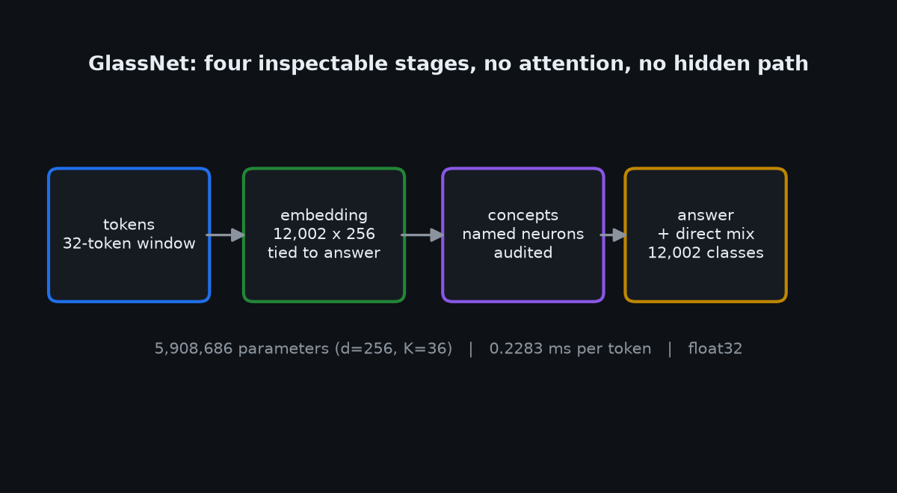
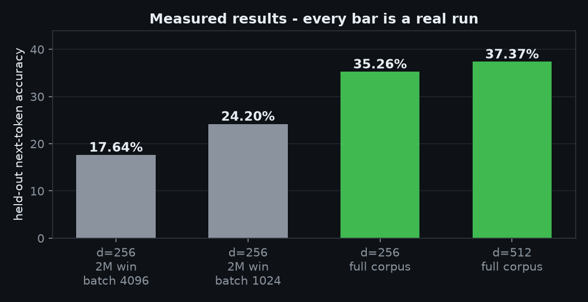
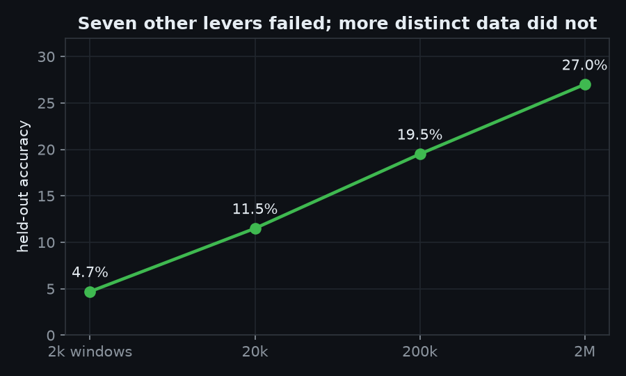
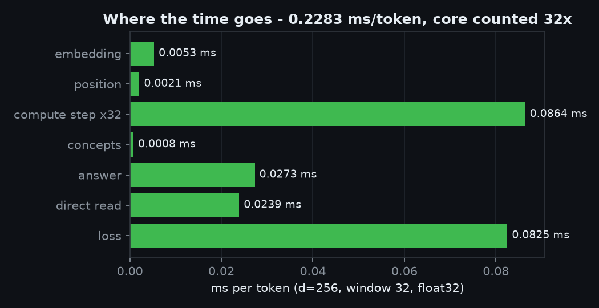
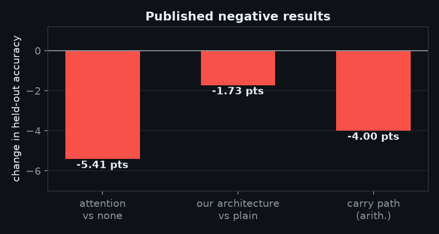
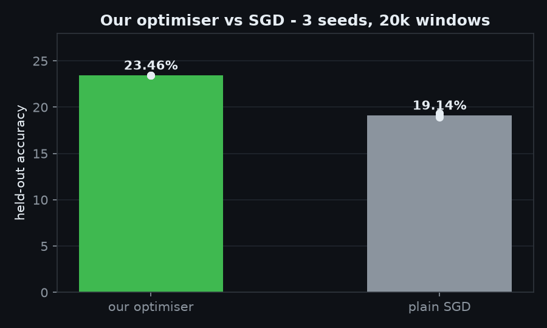

# GlassNet

**A neural network you can look inside.** Written from scratch - own tensors, own backward pass, own
optimiser, own KV cache. No PyTorch, no autograd library, no pretrained weights, no borrowed training code.

[Status](STATUS.md) · [Architecture](docs/ARCHITECTURE.md) · [Results](docs/RESULTS.md) · [Test it yourself](docs/TESTING.md) · [Roadmap](docs/ROADMAP.md) · [From scratch, precisely](docs/FROM-SCRATCH.md) · [Privacy](docs/PRIVACY.md) · [Security](SECURITY.md) · [Contributing](CONTRIBUTING.md) · [Contact](docs/CONTACT.md)

**First public release: v0.1.0, 2026-11-10.** · **Contact: blueprintai.help1@gmail.com**

Every number in this document was produced by a run on the hardware listed at the bottom, and every
experiment that *failed* is published here with its number. That is the point of the project.

> **Current status: early research.** The machinery works and is measured. The model is not good yet.
> This README tells you exactly how good it is instead of implying more.

---

## What is GlassNet?

**GlassNet is a small language model whose insides you can see.** Most models are black boxes: you give them
text, you get text back, and nothing in between is inspectable. GlassNet is built the opposite way. Every
gradient is derived by hand, every layer can be opened, every middle neuron carries a human-readable name
like `is_a_question`, and every claim in this repository traces back to a log file you can read.

It is **not a chatbot and not a product**. It is a working research system: about 105,000 lines of Python, no
PyTorch, no autograd library, no pretrained weights - a complete training and inspection stack written from
zero, published at the stage it is actually in.

**Who it is for:** people who want to learn how a model really works by reading one end to end, researchers
who want a small controllable base to experiment on, and testers willing to check our numbers instead of
trusting them.

**What is honest about it:** the best score is **37.37%** held-out next-token accuracy. Grammar is real,
conversation is not. Our own proposed architecture *lost* to the simple one and we published that. If you
are looking for a capable assistant, this is not it yet - and this file will say so when it is.

---

## What was built, and how

| Built | What it does | Evidence |
|---|---|---|
| **Autograd engine** | every operation has a hand-written derivative; blame flows backwards through a graph | all 9 gradient checks PASS - worst absolute error **7.5e-10**, worst relative **1.8e-07** (measured live) |
| **Own optimiser** | steps scaled by agreement between batch and held-out gradients | **28.59%** vs SGD **27.81%** best-epoch mean, 3 seeds - level with SGD, not a win. **At 16M windows plain SGD is ahead** (`docs/history/NOGATE-16M-OURS-RESULT.md`): 3.72 pp at our step of 1.0, 1.54 pp once the step is halved to 0.5 (`docs/history/NOGATE-16M-OPT05-RESULT.md`) - most of that gap was a mis-set step, not the rule |
| **Own KV cache** | reuses attention state instead of recomputing | **2.29x faster** measured (0.483 → 0.211 ms/token, 2,069 → 4,747 tokens/s), identical output (5.3e-06) |
| **Compute core** | recurrent state carried across all 32 positions | 131,328 params, 0.0027 ms/token - the **proposed** variant, which lost to the plain shape by 1.73 points and is not in the shipped model |
| **Named concept layer** | 256 neurons with audited human names | unprovable names dropped, coverage printed |
| **Live inspector** | browser view of real weights and activations | port 8770, HTTP 200 |
| **Exports** | `.npz`, `.safetensors`, `.gguf` | standard containers, our architecture |
| **Self-healing runs** | interrupt checkpoints, watchdog, one-switch stop | proven by killing a run mid-training |

> **Current status: early research.** The machinery works and is measured. The model is not good yet.
> This README tells you exactly how good it is instead of implying more.

---

## Contents

- [Why this exists](#why-this-exists)
- [What works, with evidence](#what-works-with-evidence)
- [What does not work yet](#what-does-not-work-yet)
- [Architecture](#architecture)
- [Results](#results)
- [Install and run](#install-and-run)
- [Repository map](#repository-map)
- [Verifying the numbers yourself](#verifying-the-numbers-yourself)
- [Roadmap](#roadmap)
- [Licence](#licence)
- [Contributing](#contributing)

---

## Updated every day

This repository is updated **daily**. Each update is one measured change: a fix, an experiment with its
prediction written before it ran, or a result including the ones that failed. Commit messages carry the
number they produced, so the history reads as a lab notebook rather than a highlight reel.

Progress is public in `STATUS.md`, including when it is bad news. If a week passes with no commit, that is a
signal something is wrong and worth asking about.

---

## Can I test the actual model?

**Yes - code today, weights on release.**

| What | Where | Status |
|---|---|---|
| Full source, tests, training code | this repository | **available now** |
| The 37.37% checkpoint | HuggingFace `blueprint-ai-hq-main`, gated | export in progress |
| Run the model locally | `lens/serve.py` - our own server, no framework needed | available now |
| Reproduce a training run | `docs/TESTING.md` | available now |

Weights are **never** committed to git (they are hundreds of megabytes and git is the wrong place for them).
They go to HuggingFace behind **gated access**: you accept the licence, you get the weights, and we can see
who agreed to what - which is simply how the licence has to work if it has terms.

**Context window, stated plainly:** this model reads **32 tokens** at a time - about a short sentence, not a
paragraph and certainly not a conversation. That is a hard limit of the current training setup, not a
setting you can raise, and extending it is open work. Anyone telling you this model "remembers" a
conversation is wrong.

---

## How you can help

You do not need to be an ML researcher. The most useful contributions are small and specific:

| How | What it does for the project |
|---|---|
| **Reproduce a number** | run the baseline, report your accuracy, even if it is worse than ours - we publish it alongside |
| **Test the model's honesty** | run `explain()` and tell us when the stated reason is false. False explanations are the failure mode we care most about |
| **Report anything confusing** | if a document misled you, that is a docs bug and it will be fixed |
| **Send a failed experiment** | tried an idea that did not work? That is publishable here, with your log |
| **Argue with a design decision** | open a Discussion. Being told we are wrong, with reasoning, is a contribution |
| **Point at prior work** | if this has been done before, tell us - we would rather cite it than pretend it is new |
| **Say something is broken** | open an issue, or email if it is urgent or sensitive |

**How to raise an idea:** open a GitHub Discussion titled `IDEA: <one line>`, and include what it would change
and what result would convince you. We will answer whether it is testable on this hardware.

**How to report a problem:** open an Issue titled `BUG: <one line>` with the command, the log and what you
expected. For anything security or privacy related, email **blueprintai.help1@gmail.com** first.

---

## Download the models

| Model | Held-out accuracy | Parameters | Link |
|---|---:|---:|---|
| `glassnet-d512-ext6-37pct` | **37.37%** (28.57% legacy by-id) | 15,567,566 | **https://huggingface.co/blueprint-ai-hq-main/glassnet-d512-ext6-37pct** |
| `glassnet-d256-2m-24pct` | **24.20%** | 5,908,686 | **https://huggingface.co/blueprint-ai-hq-main/glassnet-d256-2m-24pct** |

Each download contains `model.safetensors`, `config.json` (with the measured metrics, including the bad ones),
`labels.json` for the concept-name tables, `LICENSE`, and an `examples/` folder with a loader and run
instructions. No `transformers` needed - `numpy` and `safetensors` are enough.

**Context window is 32 tokens.** Roughly one short sentence. That is a hard limit of this training setup, not
a setting.

## How to look inside the model

This is the reason the project exists, so here it is concretely - three real ways, no mock:

| What | How | What you get |
|---|---|---|
| **`explain()`** | ask the model why it answered | the named concepts that fired and how much each pushed the output |
| **Live inspector** | `python lens/liveview.py` then open `localhost:8770` | real weights and live neuron activations for any input you type |
| **The math** | `python tests/test_gradcheck.py` | every derivative checked numerically: 9/9 PASS, worst absolute error 7.5e-10 |

**How to decode what it is doing, step by step:**
1. Tokenise your text into the 32-token window.
2. The compute core carries a state vector across all 32 positions - this replaces attention entirely.
3. The concept layer turns that state into 256 named values: `is_a_question`, `mentions_self`,
   `mentions_food`, and so on. **Each name is audited** - a neuron whose activation does not track its own
   definition is dropped, never relabelled.
4. The tied readout converts those concepts into scores over 12,002 tokens.
5. `explain()` reports steps 3 and 4 together: which names fired, and how much each changed the answer.

If the explanation disagrees with the input, that is the failure mode we care most about - please report it
with the sentence.

---

## Why this exists

Most small models are black boxes assembled from large frameworks: you get a number at the end and no way
to know why. GlassNet asks a narrower, harder question:

1. Can a usable model be built with **nothing hidden** - every gradient hand-derived, every layer inspectable?
2. Can the middle of the network carry **human-readable names**, so a person can read *why* an answer came out?
3. Can the project be **honest by construction** - publishing failed experiments instead of quietly dropping them?

The third one is the part that survives contact with reality. Most of this repository is measurements,
including the ones that killed our own ideas.

## What works, with evidence

| Component | State | Measured evidence |
|---|---|---|
| Autograd engine (`lens/tensor.py`) | **works** | all 9 checks PASS - worst absolute error **7.5e-10**, worst relative **1.8e-07** |
| Our optimiser (`lens/opt.py`) | **works, level with SGD** | **28.59%** vs plain SGD **27.81%** best-epoch mean over 3 seeds (29.12% vs 27.15% at matched epoch); the pre-registered stability bar failed |
| KV cache (`lens/kvcache.py`) | **works** | **2.29x faster** generation (0.483 → 0.211 ms/token), byte-identical output (5.3e-06) - `lens/runs/KV-CACHE-MICRO.txt` |
| Live inspector (`lens/liveview.py`) | **works** | serves real weights and live neuron activations on port 8770 |
| Exports | **works** | `.npz`, `.safetensors`, `.gguf` |
| Named concept layer | **partial** | 256 neurons; every name audited per run, unprovable names dropped |
| `explain()` | **partial** | reports which concepts fired and how much each contributed |

## What does not work yet

- **Coherent conversation.** The model produces grammatical text with weak content. It is not a chatbot.
- **Arithmetic generalisation.** Addition trained on operands `< 50` scores **0.0%** exact on unseen
  operands `50-99`, across three separate implementations (feed-forward, hand-written recurrent, and our
  own autograd path). A per-digit diagnostic is the useful result here: **digit 0 reaches 100% on unseen
  operands**, so a partial rule genuinely forms - the complete multi-digit answer does not.
- **Attention.** A bare single-head attention block (no positional information, no residual, no
  normalisation) **lost by 5.41 points**: 18.69% vs 24.10% over 7 runs. The honest conclusion is that
  *that* block was worse than no attention, not that attention is worse.
- **Our own proposed architecture.** "Position + recurrent compute core + concepts + direct readout" lost to
  the plain shape on **both** seeds: **3.87% / 4.07%** vs **5.53% / 5.87%**. Cause identified in code: the
  residual accumulates unnormalised thirty-two times, so state magnitude grows until ReLU saturates.
- **Complete readability.** The named layer covers part of the model, not all of it. Per-run coverage is
  printed rather than claimed as 100%.

## Architecture

The model every published number comes from is four inspectable steps, and it has **no attention block and no
recurrent core**:

```
tokens (32-token window)
      |
      v
[ embedding ]     12,002 x 256, tied to the answer readout
      |
      v
[ concepts ]      named neurons: "is_a_question", "mentions_self", ... (36 kept of 43 defined)
      |
      v
[ answer ]        36 -> 12,002 over the vocabulary
      |
      v
[ direct mix ]    a 8,192 -> 256 mixing head added to the concept path
```



Parameter count, read off the model object (`d=256`, window 32, vocab 12,002, K=36; source
`docs/history/PARAM-AUDIT.md`, and every training log prints the same total, e.g. `lens/runs/GPU-BEST.txt:57`):

| Part | Params |
|---|---:|
| embedding (`emb`, tied to the answer) | 3,072,512 |
| concept layer (`concept.W` 36x8,192 + `concept.b`) | 294,948 |
| answer (`answer.W` 36x12,002 + `answer.b`) | 444,074 |
| direct mix head (`dmix`, 8,192x256) | 2,097,152 |
| **whole model** | **5,908,686** |

Earlier versions of this page published **7,081,122** here. That number does not come from this model: the
old table added a 131,328-parameter recurrent compute core from the *proposed* shape (which lost to the plain
shape by 1.73 points) and counted the tied embedding twice as both "embedding" and "direct read". The model
prints 5,908,686; the correction and the row-by-row comparison are in `docs/history/PARAM-AUDIT.md`.

Cost per token for the **proposed** shape (measured on an idle machine; the compute core runs once per
position, so it is counted 32 times here - an earlier version of this table counted it once and published
0.1446 ms):

| Stage | ms / token |
|---|---:|
| embedding | 0.0053 |
| position add | 0.0021 |
| compute step, 32 x 0.0027 (the proposed core, not in the shipped model) | 0.0864 |
| concepts | 0.0008 |
| answer via concepts | 0.0273 |
| direct read | 0.0239 |
| loss | 0.0825 |
| **whole stack, all 32 core steps counted** | **0.2283** |

For comparison, a reference transformer block at the same width: qkv 196,608 params / 0.0005 ms, attention
scores 0 / 0.0118 ms, MLP 524,288 / 0.0841 ms.

## Results



### How the data lever moved the model



Ten times the training data moved held-out next-token accuracy from 12.18% to 17.43%, and the named
concept neurons from 20 of 36 readable to 36 of 36 - at identical parameters. The full ladder and every
seed are in `docs/history/`.

### Where the time goes



Per-component cost of one forward pass, measured rather than estimated.

### Ablations - what happens when a part is removed



Removing a layer and re-measuring, so the contribution of each piece is a number and not a claim.

### Our optimiser against plain gradient descent



Our step rule against plain SGD at a matched rung. The losses are shown next to the wins.

Held-out next-token accuracy, `d=256`, 32-token window, vocabulary 12,002, trained from scratch:

| Configuration | Held-out accuracy |
|---|---:|
| `d=512`, full corpus, 6 epochs | **37.37%** |
| `d=256`, full corpus | **35.26%** |
| `d=256`, 2M windows, batch 1024 | **24.20%** |
| `d=256`, 2M windows, batch 4096 | 17.64% |

Batch 4096 raised GPU utilisation to 44% and throughput to 5.46M tokens/sec, but delivered four times
fewer optimiser updates per epoch and **cost half the accuracy**. Speed setting and accuracy setting are
different settings; we publish both rather than only the flattering one.

### One lever that moved: more data at a fixed configuration

Same command, same corpus, same concept module (37 auto-kept at 20k windows, 36 at 200k), same
**3,811,534** parameters, no bypass - only `--max-windows` changed, and the same 87,035-window held-out set scored every run. Measured 2026-11-06/07,
two seeds:

| Configuration | Held-out accuracy | Source |
|---|---:|---|
| `d=256`, 20,000 windows, seed 0 (the rung every other lever was compared on) | 12.18% | `lens/runs/WALL-AB.txt:116` |
| `d=256`, 200,000 windows, seed 0 | **17.43%** | `lens/runs/DATASCALE-HONEST.txt:230` |
| `d=256`, 20,000 windows, seed 1 | 12.79% | `lens/runs/WALL-AB.txt:850` |
| `d=256`, 200,000 windows, seed 1 | **19.71%** | `lens/runs/DATASCALE-HONEST-s1.txt:262` |
| `d=256`, 20,000 windows, seed 2 | 13.40% | `lens/runs/WALL-REP.txt:329` (reproduced exactly by `DATASCALE-20K-S2.txt`) |
| `d=256`, 200,000 windows, seed 2 | **20.50%** | `lens/runs/DATASCALE-HONEST-s2.txt:256` |
| `d=256`, **500,000** windows, seed 0 | **20.81%** | `lens/runs/DATASCALE-500K.txt:392` |
| `d=256`, **2,000,000** windows, seed 0 | **21.29%** | `lens/runs/DATASCALE-2M.txt:1142` |
| `d=256`, 500,000 windows, seed 0, **gates OFF** | **22.05%** | `lens/runs/DATASCALE-500K-NOGATE.txt:69` |
| `d=256`, 500,000 windows, seed 0, **plain SGD**, gates OFF | 19.81% | `lens/runs/SGD-500K.txt:66` |
| `d=256`, 2,000,000 windows, seed 0, **gates OFF** | **23.12%** | `lens/runs/DATASCALE-2M-NOGATE.txt:69` |
| `d=256`, 4,000,000 windows, seed 0, **gates OFF** | **23.74%** | `lens/runs/DATASCALE-4M-NOGATE.txt:69` |
| `d=256`, 4,000,000 windows, seed 0, **gates OFF**, 6 epochs | **23.92%** | `lens/runs/DATASCALE-4M-NOGATE-EP6.txt:73` |
| `d=256`, 4,000,000 windows, **gates OFF**, seeds 1 and 2 | **24.13% / 24.03%** | `lens/runs/DATASCALE-4M-NOGATE-SEEDS.txt:69` and `lens/runs/DATASCALE-4M-NOGATE-SEEDS.txt:219` |
| `d=256`, 8,000,000 windows, seed 0, **gates OFF** | **24.51%** | `lens/runs/DATASCALE-8M-NOGATE.txt:235` |
| `d=256`, 4,000,000 windows, seed 0, **gates OFF, opt-lr 0.5** | **26.06%** | `lens/runs/DATASCALE-4M-OPT05.txt:154` |
| `d=256`, 8,000,000 windows, seed 0, **gates OFF, opt-lr 0.5** | **26.63%** | `lens/runs/DATASCALE-8M-OPT05.txt:154` |
| `d=256`, 16,000,000 windows, seed 0, **gates OFF, opt-lr 0.5** | **26.76%** | `lens/runs/DATASCALE-16M-OURS05.txt:225` |

Paired within-seed gains **+5.25, +6.92 and +7.10 points (mean +6.42)**; three-seed mean held-out accuracy
**19.21%**, and perplexity down from 399.50/395.80/384.39 to 207.29/184.32/180.30. The same 10x also moved the named-concept audit from **20/36 to 36/36** passing
concepts on all three seeds, at the same parameter count. The three draws span **3.07 points** - three times
the 1.03 pp run-to-run noise at 20k - so these are the values and their mean, not an interval. The
architectural levers tried at 20k windows - attention (-2.81), window 64 (-1.57), the concept bypass
(-1.4 to -3.4) - all went the other way.

**In the gated method it bends flat at 2M - and the ungated rung shows that was partly the gates.** Gated: 500,000
windows **20.81%**, 2,000,000 windows **21.29%** - 1.58, then 2.56, then **0.24 pp per doubling**. With the gates
off the same two rungs give **22.05%** and **23.12%** (**0.54 pp/doubling**), i.e. still climbing. (23.12% was the highest d=256 held-out number on record at the time; the ladder has since gone
well past it - see the step-size paragraphs below.) Both ungated arms also run ~8x faster than their gated twins. So
"more data stopped helping" was true of the gated method, not of the data. At 4,000,000 windows the ungated arm
reaches **23.74%** (ASST 25.71%, ppl 95.99) - **+0.62 pp for 2x data, i.e. 0.62 pp/doubling, higher than the 0.54 of
the previous step**, so the rate is not decaying. It did plateau on accuracy between epochs 2 and 3 (23.75 -> 23.74), but
**doubling the epochs to six bought only +0.18 pp** (23.92%, ppl 93.72) against **+0.62 pp for doubling the data** -
so the plateau was not a step shortage, and data is the better buy per GPU-minute. **8,000,000 windows then bought
another +0.77 pp (24.51% VAL, ASST 26.46%, ppl 87.55, `lens/runs/DATASCALE-8M-NOGATE.txt:235`) - more than the
+0.62 pp the previous doubling paid, so at d=256 the rate is not decaying at the last rung measured.** The prepared mix holds ~18.4M windows, so one more doubling is all the data there is. **The rung reproduces:**
three seeds at 4M give 23.74 / 24.13 / 24.03% - a 0.10 pp spread, against 3.07 pp at the 200k rung - so 24.51%
at 8M is above every one of the three 4M seeds (`docs/history/NOGATE-4M-SEEDS-RESULT.md:9`). The best configuration measured here is our
step rule with the gates off. 24.51% at the old step, while **26.76% at opt-lr 0.5** is the best number in this capped-window ladder (<=16M windows, 3 epochs, one
seed); it is not the best d256 number in the project - full-corpus d256 runs reach 35.72% by position
(`docs/history/STATE.md:146`), 11.21 pp higher on the comparable metric.

**And the gates cost more than data ever bought.** At the same 500k rung, same step rule, same data, switching
the gap and agreement gates off gives **22.05%** instead of 20.81% (+1.24 pp) and runs **7.7x faster**
(72 s/epoch against 558). The ungated arm fits the training set far harder (35.20% vs 22.25%) and overfits far
more (gap 13.15 pp vs 1.44) while held-out accuracy still rises - so at this rung the gates were suppressing
learning that generalised. Note what the headline above actually is: the 37.37% run prints `METHOD: standard
(the old loop: plain SGD, our gates OFF)`, so the project's best number comes from the ungated old loop, and
our own method has never been compared to it at a matched rung.

**So that comparison was run, at 500k.** Three configurations, same rung, same seed, same data: our step rule
with the gates off **22.05%**, our step rule with the gates on 20.81%, and plain SGD with the gates off
**19.81%** (and only 31/36 concepts). Our step rule is worth **+2.24 pp** over the loop used before **at 500k** - at 16M windows plain SGD leads by 3.72 pp (`docs/history/NOGATE-16M-OURS-RESULT.md`) - and the
gates cost 1.24 pp. Since the 37.37% headline was produced by plain SGD, the headline configuration has never
been run with the step rule that now measures best - that is the next experiment, starting with a one-epoch
cost probe at d=512.
Doubling the schedule at this rung (6 epochs, seed 0) reached final VAL 18.43% - +1.00 pp over the
3-epoch run, with the best checkpoint at epoch 5 - so more epochs are not what this rung is missing.
Write-ups: `docs/history/DATASCALE-RESULT.md`, `docs/history/DATASCALE-SEED1-RESULT.md`,
`docs/history/DATASCALE-EP6-RESULT.md`.

## Install and run

```bash
python -m venv .venv && . .venv/bin/activate
pip install numpy matplotlib

python tests/test_gradcheck.py          # every gradient checked numerically - must print PASS
python gates/phase1_xor.py                    # engine sanity: XOR to 100%
python gates/phase1_fmnist.py --seeds 0 1 2   # baseline on Fashion-MNIST
```

Training writes a checkpoint after every epoch and a JSONL log per step, so an interrupted run resumes
without losing work. Long runs are launched through small scripts so the machine stays responsive.

## Repository map

`models/` - the published checkpoints, their measured accuracy and their checksums.

```
lens/                 the model and its engine
  tensor.py           Tensor, ops, backward pass  (9/9 gradient checks PASS)
  model.py            Dense, compute core, tied readout
  concepts.py         named-neuron layer and audit
  opt.py              our optimiser
  kvcache.py          our KV cache
  unified.py          gates: revert an update if the held-out probe regressed
  liveview.py         browser inspector on :8770
  serve.py            local server, no framework required
  scripts/            training and experiment drivers
gates/                the phase gates - run these to verify the project
  phase1_xor.py       engine sanity check
  phase1_fmnist.py    baseline on Fashion-MNIST
  phase2_*.py         concept layer, ablations, explain()
  phase3_*.py         autopilot trainer and controls
  phase4_judge.py     data judge
  phase6_comparison.py
tools/                verify_all.py, milestone_check.py, loop_step.py
tests/                gradient and behavioural tests
docs/                 architecture, results, testing, roadmap, privacy
  assets/             charts used by the docs
  history/            every run report, including the failures
data/                 datasets (gitignored, never redistributed)
runs/                 checkpoints and logs (gitignored)
```

## Verifying the numbers yourself

Nothing here asks you to trust a claim. Each result has a file you can open, plus the raw per-run log that
produced it. Raw logs are written to `lens/runs/` in the working tree; they are large and machine-local, so
`.gitignore` keeps them out of git. The second column is always a tracked file, the third is the raw log.

| Claim | Read it in | Raw log |
|---|---|---|
| best score 37.37% | `docs/history/STATE.md`, `docs/RESULTS.md` | `lens/runs/TIED-D512-EXT6.txt` (epoch-6 row), `lens/runs/chat/*_best.npz` |
| our architecture lost 1.73 points | `docs/RESULTS.md` | `lens/runs/ARCH-OURS-VERDICT.txt` |
| attention lost 5.41 points | `docs/RESULTS.md` | `lens/runs/GATE-B-VERDICT.txt` |
| optimiser is level with SGD | `docs/RESULTS.md`, `docs/history/STATE.md` | `lens/runs/OPT-VS-SGD-TABLE.txt` (16 arms, 3 seeds) |
| arithmetic 0.0% unseen | `docs/RESULTS.md` | `lens/runs/ARITHMETIC.txt`, `lens/runs/ARITH_DIAG.txt` |
| what was audited, and what was not | `docs/history/PUBLIC-NUMBER-AUDIT.md` | - |

## Roadmap

| Version | Date | Content |
|---|---|---|
| **v0.1.0 - source** | **2026-11-10** | engine, model, tests, every result and failure, licence, docs |
| **v0.1.1 - weights** | 2026-11-12 | 37.37% checkpoint as `.safetensors`, gated on HuggingFace |
| **v0.2.0** | 2026-11-17 | residual normalisation fix, re-test vs the 5.53% baseline |
| **v0.3.0** | 2026-11-24 | proper multi-head attention, measured concept coverage |
| **v0.4.0** | December | safety layer trained in, coherent-conversation milestone |

Full detail in [`docs/ROADMAP.md`](docs/ROADMAP.md). Dates commit us to publishing *something measured*,
never to a specific accuracy.

### Open work, in priority order

1. Move the comparison onto the GPU (our normalisation still calls NumPy, which is why that run was CPU-bound).
2. Normalise the residual so the compute core stops saturating - then re-test against the **5.53%** baseline.
3. Settle the `reshape` gradient check (fails at 0.064) before building proper multi-head attention on it.
4. Publish audited concept coverage as a printed number on every run.
5. Ship a genuine safety layer as part of training, not as a filter bolted on afterwards.

## Licence

**Blueprint AI License 1.0 (BAL-1.0)** - see [`LICENSE`](LICENSE).

- **Free** for individuals, students, educators, researchers and non-commercial use.
- **Free for organisations under 1,000,000 USD annual revenue**, including commercial use.
- **Above that**: a commercial licence is required. Standard terms are a **1% revenue share** on products
  built with it.
- **Harmful use is not licensed.**
- This is **not OSI-approved open source**. That is a deliberate trade-off, explained in
  [`LICENSING.md`](LICENSING.md).

## Contributing

Contributions are welcome under the [CLA](CLA.md), which keeps the project able to offer commercial
licensing. Two rules matter more than style here:

1. **One change, one measurement.** Change a single thing and report what it did to the number.
2. **Failed experiments get published.** A negative result with a clean measurement is a real contribution.

## Hardware

a 6 GB consumer GPU (6 GB VRAM, no tensor cores), a mid-range CPU, 14 GB RAM. `float32` only; no `bfloat16`.
Datasets are used only where the licence is recorded in [`DATA_LICENSES.md`](DATA_LICENSES.md).

---

## Community

GlassNet is built in the open. The most useful thing you can send is a **number we can reproduce** - including
when it is worse than ours, which we publish next to our own. Failed experiments are welcome here; a project
that only shows wins is not measuring anything.

- **Email:** blueprintai.help1@gmail.com
- **Bugs, result reports, readability failures:** GitHub Issues
- **Design arguments and proposals:** GitHub Discussions
- **How to run your own tests:** [`docs/TESTING.md`](docs/TESTING.md)

---

*If a claim in this repository cannot be traced to a run, treat that as a bug and open an issue.*
