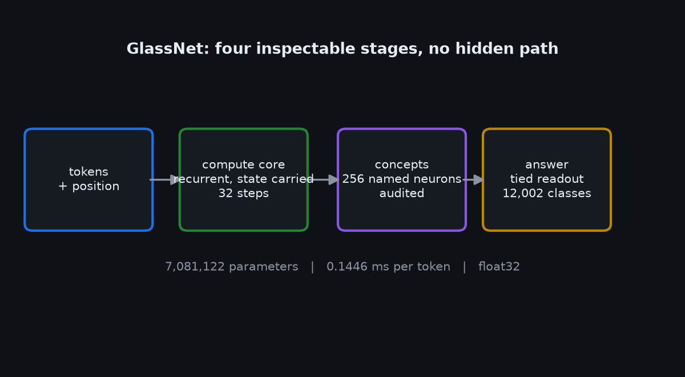
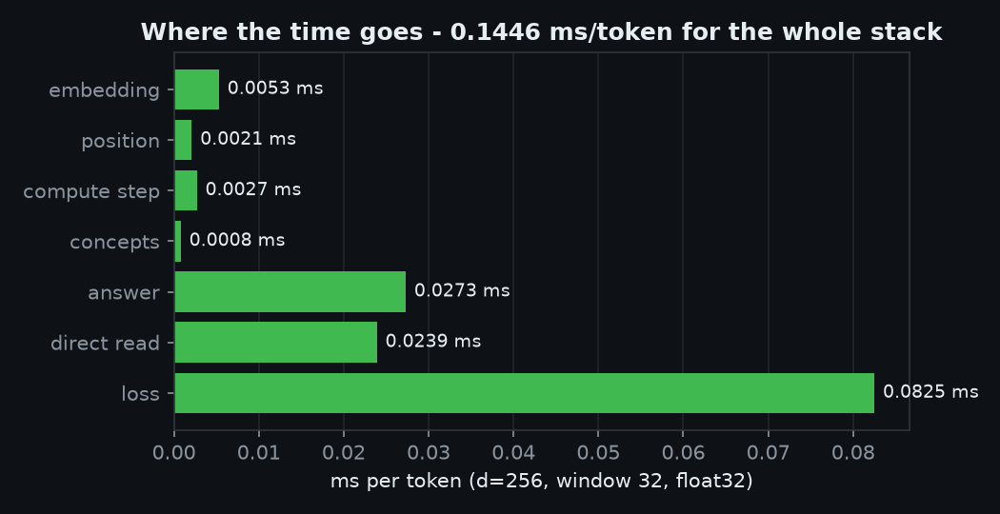

# How GlassNet works, exactly

Four stages. No hidden path, no framework, no pretrained weights.

## 1. Engine (`lens/tensor.py`)

A `Tensor` holds a NumPy array, a gradient slot, and - if it was produced by an operation - a closure that
knows how to push blame backwards. `backward()` topologically sorts the graph from the output, seeds the
output gradient with ones, then walks the list in reverse calling each closure. Gradients accumulate with
`+=`, which is what makes shared parameters (the tied readout) correct.

Every operation has a hand-written derivative:

| Op | Forward | Backward |
|---|---|---|
| add | `a + b` | sum over broadcast dims |
| multiply | `a * b` | `grad*b`, `grad*a` |
| matmul | `A @ B` | `grad @ B.T`, `A.T @ grad` |
| ReLU | `max(x,0)` | `grad * (x>0)` |
| sigmoid | `1/(1+e^-x)` | `grad * s * (1-s)` |
| cross-entropy | `-log softmax[y]` | `(softmax - onehot)/N` |

All of them are checked against central-difference numerical gradients in `tests/test_gradcheck.py`. Re-run on 2026-11-06: all 9 checks PASS, worst absolute error **7.5e-10**, worst relative
**1.8e-07** on matmul (the loosest), and the full Dense->ReLU->Dense->cross-entropy network at
**1.2e-10** absolute. No op is used in the model until its check
passes - which is exactly why `reshape` (0.064 error) is *not* used anywhere.

## 2. Compute core

Each window of 32 tokens is processed position by position. The core carries a state vector across the 32
steps, so information flows forward by recurrence rather than by attention. Cost: 131,328 parameters,
0.0027 ms/token - roughly 30x cheaper per token than the transformer MLP block it replaces (0.0841 ms).

Known defect: the residual adds `h = h + state` at every step with no normalisation between additions, so
magnitude grows and ReLU saturates. That is the diagnosed reason our architecture stalls at 3.87% while the
plain shape climbs to 5.53%.

## 3. Concepts

256 neurons, each carrying a name such as `is_a_question` or `mentions_self`, each trained against a
measurable definition computed from the input text. Names are **audited**: a neuron whose activation does
not track its own definition is dropped, not renamed. Per-run output prints how many names survived and the
measured coverage.

## 4. Answer

A tied readout maps concepts to the 12,002-token vocabulary. Tying shares the embedding matrix, which keeps
the parameter count honest (7.08M total at d=256) and makes the output layer readable through the same
vectors as the input.

## Cost table

