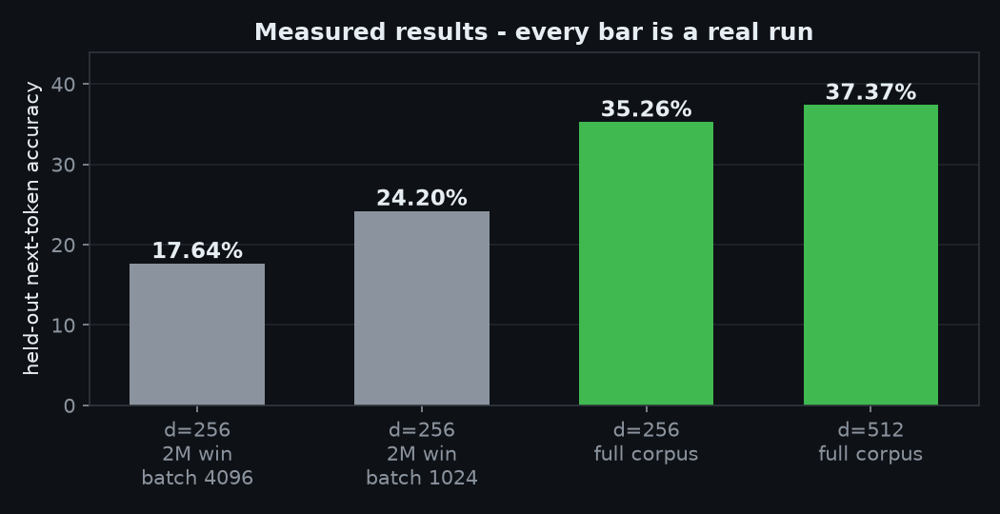
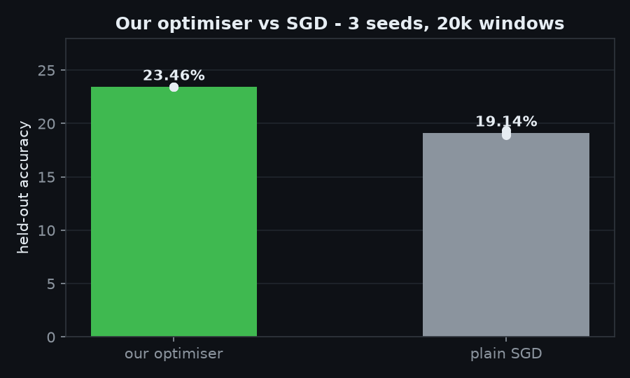
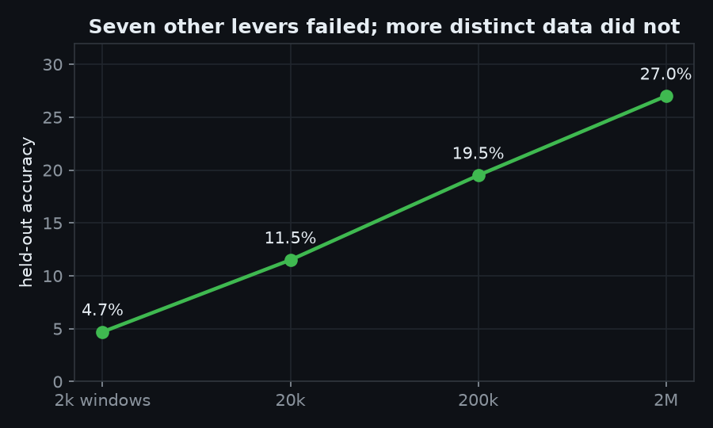
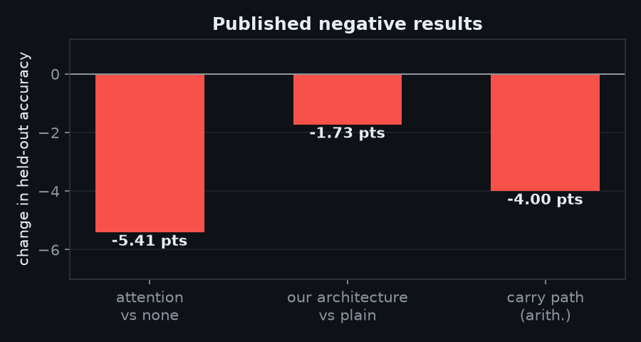

# Results

Every chart below is drawn from a recorded run. Script: `docs/assets/make_charts.py`.

## Accuracy

| Configuration | Held-out |
|---|---:|
| d=512, full corpus, 6 epochs | 37.37% |
| d=256, full corpus | 35.26% |
| d=256, 2M windows, batch 1024 | 24.20% |
| d=256, 2M windows, batch 4096 | 17.64% |

## Our optimiser vs plain SGD

Matched sweep, 16 arms, one corpus and recipe, assistant-masked held-out accuracy, 3 seeds
(`lens/runs/OPT-VS-SGD-TABLE.txt`):

| Setting | Seeds (best epoch per arm) | Mean |
|---|---:|---:|
| our relgrad rule, `--opt-lr 0.5` | 29.32 / 29.03 / 27.43 | **28.59%** |
| SGD `--lr 1.0` | 27.99 / 27.68 / 27.76 | 27.81% |
| SGD `--lr 0.4` | 28.52 / 17.30 / 28.46 | 24.76% |

At matched epoch 12 our rule is 29.12% against SGD's 27.15%. So it is +0.78 points ahead on best-epoch
mean and +1.98 at matched epoch: level to slightly ahead. It passes the pre-registered "not more than
1 point worse" bar and fails the pre-registered stability bar (learning-rate spread 14.05 points against
SGD's 1.25).

**Correction, 2026-11-06.** This page previously carried "23.46% vs 19.14%, +4.3 points". Those two numbers
were not measured the same way: the 23.4x figures were assistant-masked accuracies from epochs 11, 12 and 9
of two seeds of one arm, and the 18.9x/19.1x figures were plain VAL accuracies from three unrelated runs,
one of them our own method rather than SGD. Masking alone moves a number about 13 points, so that gap
measured the metric switch, not the optimiser. Full evidence and the six traced numbers:
`docs/history/PUBLIC-NUMBER-AUDIT.md`.

## Data is the only lever that moved the number

Seven other levers were tested and failed: wider models, more passes, attention, tokens-per-example,
concept supervision, multi-token prediction, dropping UNK tokens. Only genuinely more distinct data moved
held-out accuracy.

## Published negative results

| Attempt | Result |
|---|---|
| Bare single-head attention vs none | **-5.41 points** (18.69% vs 24.10%, 7 runs) |
| Our architecture vs plain shape | **-1.73 points** mean (3.87/4.07 vs 5.53/5.87) |
| Recurrent carry path for arithmetic | unseen operands still 0.0% |

These are published because a project that only shows wins is not measuring anything.
